# TransWork

企业级桌面 AI Agent 工作台 —— 让技能（Skills）、知识库与数字员工（Digital Employees）在同一处协作。

官网：https://transwork.tree456.com/

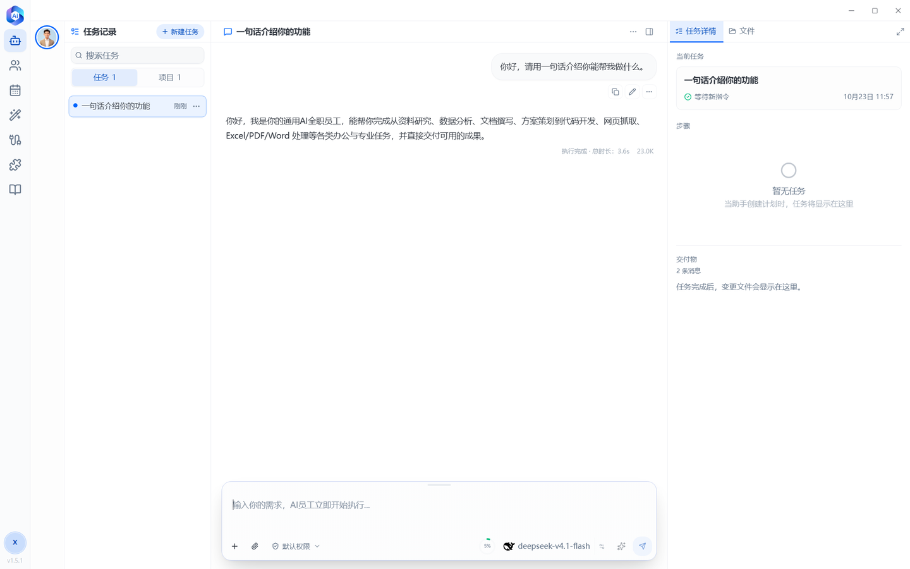

## 为什么选择 TransWork

- **一键私有部署**：Docker Compose 拉起全部服务，数据 100% 留在自己服务器
- **免费 5 席位**：内置免费授权，5 个席位、无到期时间、无功能阉割，团队小规模使用零成本
- **桌面 + 浏览器双入口**：桌面客户端功能完整，WebAgent 打开浏览器就能用，不必逐台安装
- **企业级管控**：用户/角色/资源授权、登录安全策略、审计日志开箱即用
- **模型统一网关**：集中配置模型密钥，按用户/日期/模型统计用量，密钥不下发到终端

## 界面预览

**桌面客户端**：一句话启动任务，AI 员工自动拆解步骤、调用技能、把交付物放进右栏。

| 主界面：一句话启动任务 | 对话：AI 员工边执行边交付 |
| --- | --- |
| 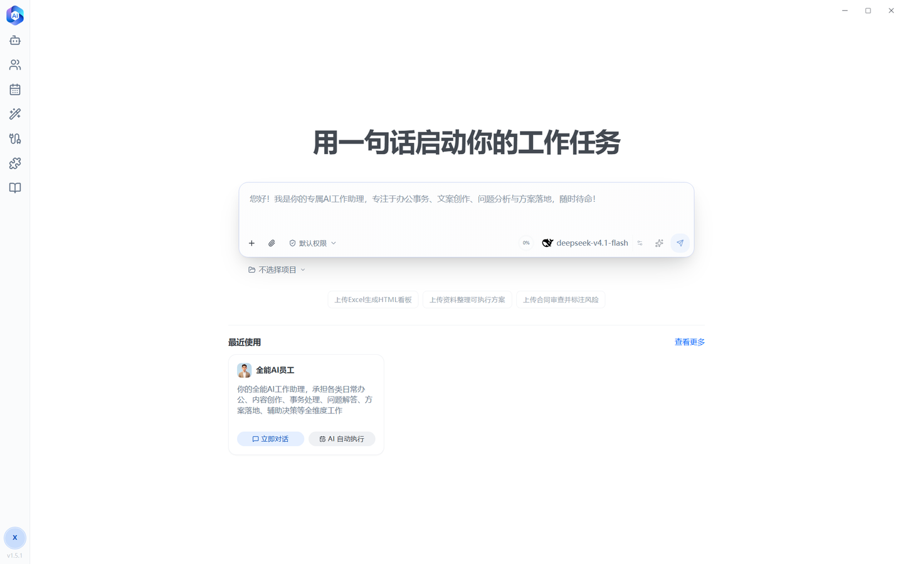 |  |
| **AI 员工目录**：按角色挑选数字员工 | **技能中心**：技能包一键获取 |
| 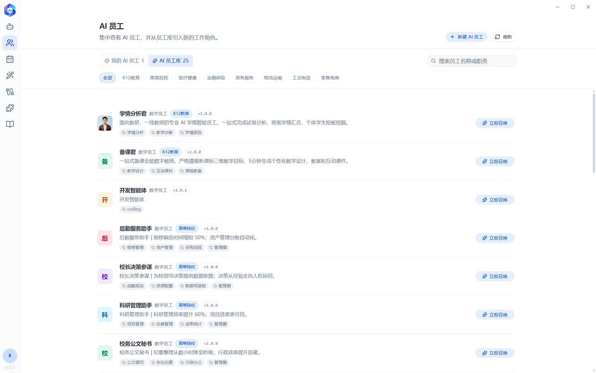 | 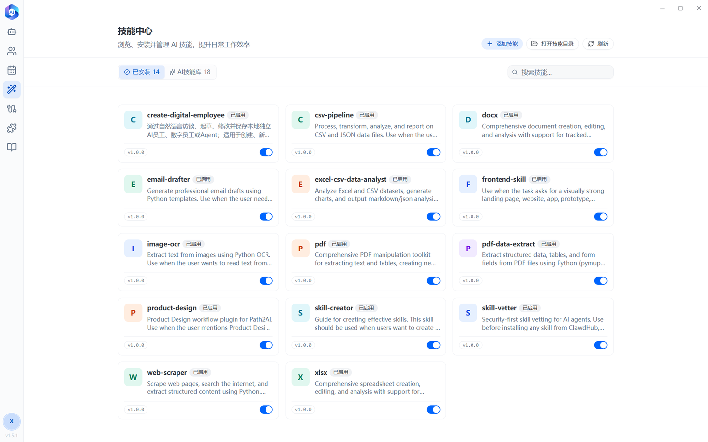 |

**浏览器版 WebAgent**：不用装客户端，打开浏览器用后台账号登录，同一套员工与技能直接开工。

| 登录：账号与权限来自后台 | 首页：直接向数字员工下达任务 |
| --- | --- |
| 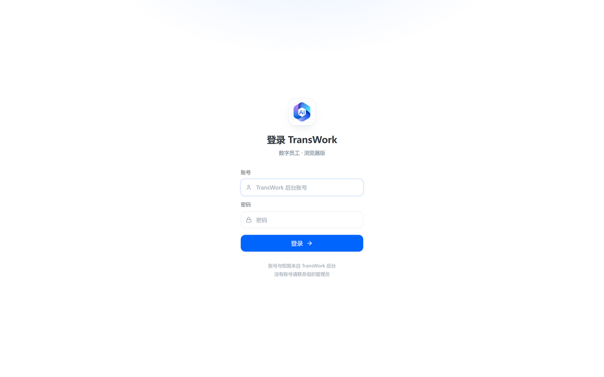 | 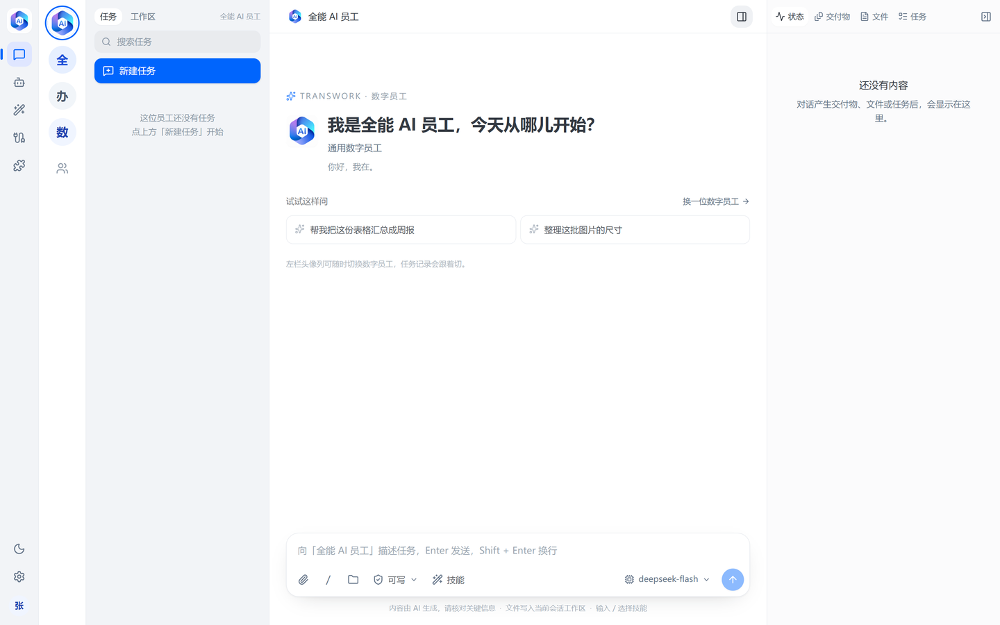 |

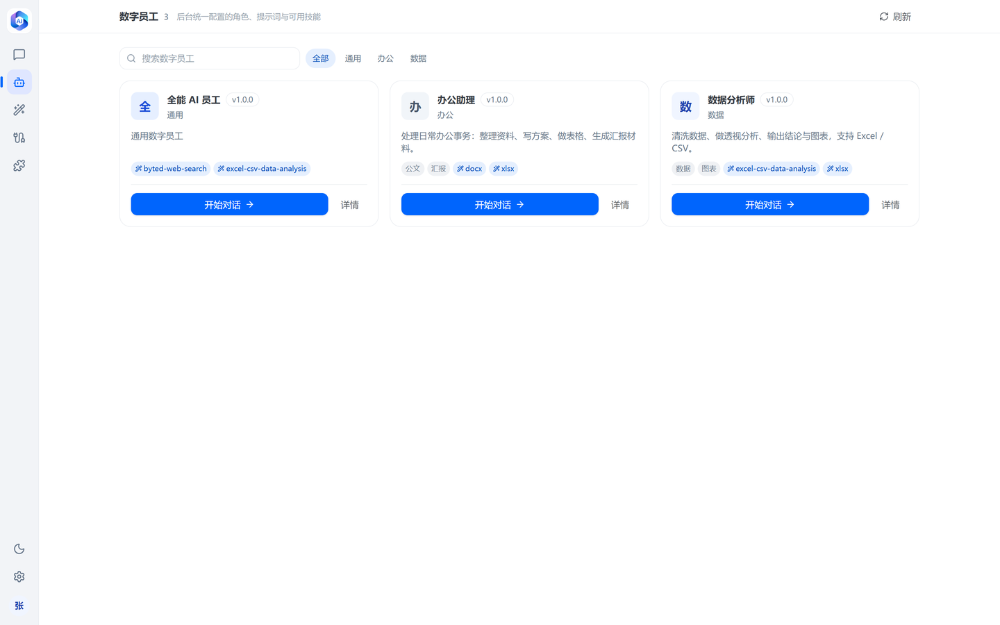

**管理后台**：系统概览、员工与技能下发、知识库、模型网关、客户端与安全策略集中管理。

| 系统概览 | AI 员工库 |
| --- | --- |
| 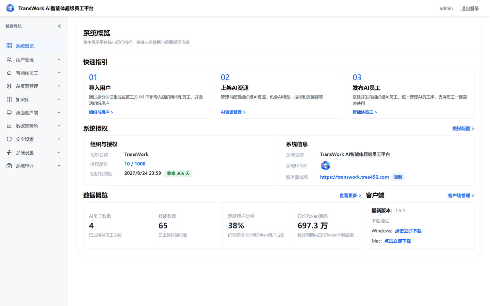 | 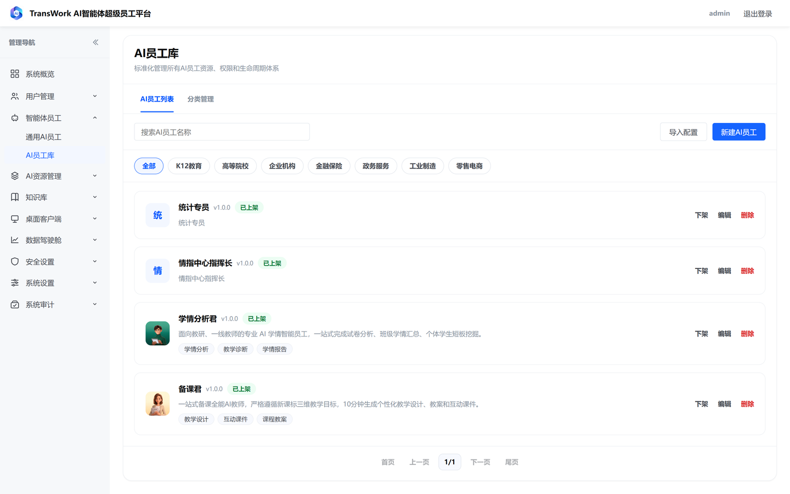 |
| **AI 技能库** | **企业知识库** |
| 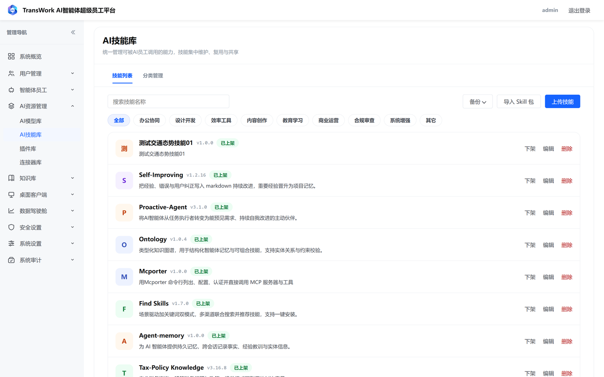 | 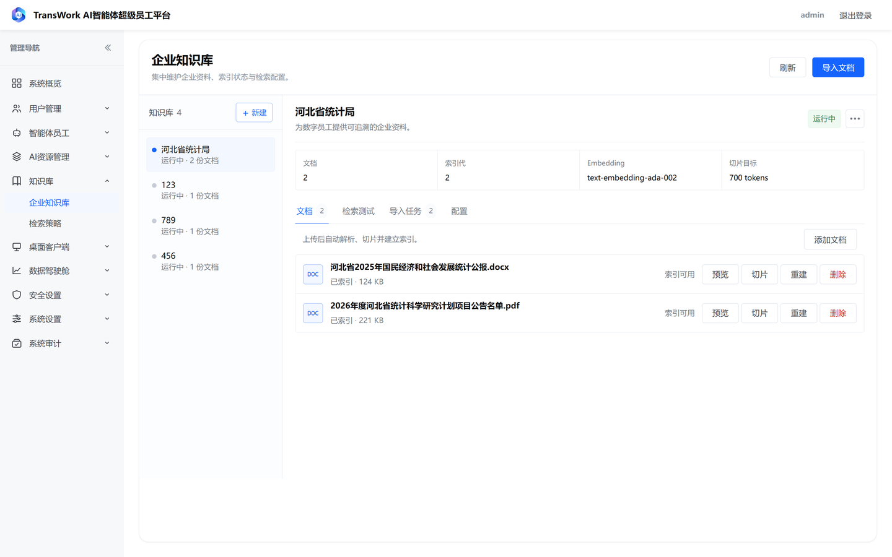 |
| **AI 模型库** | **AI 数据看板** |
| 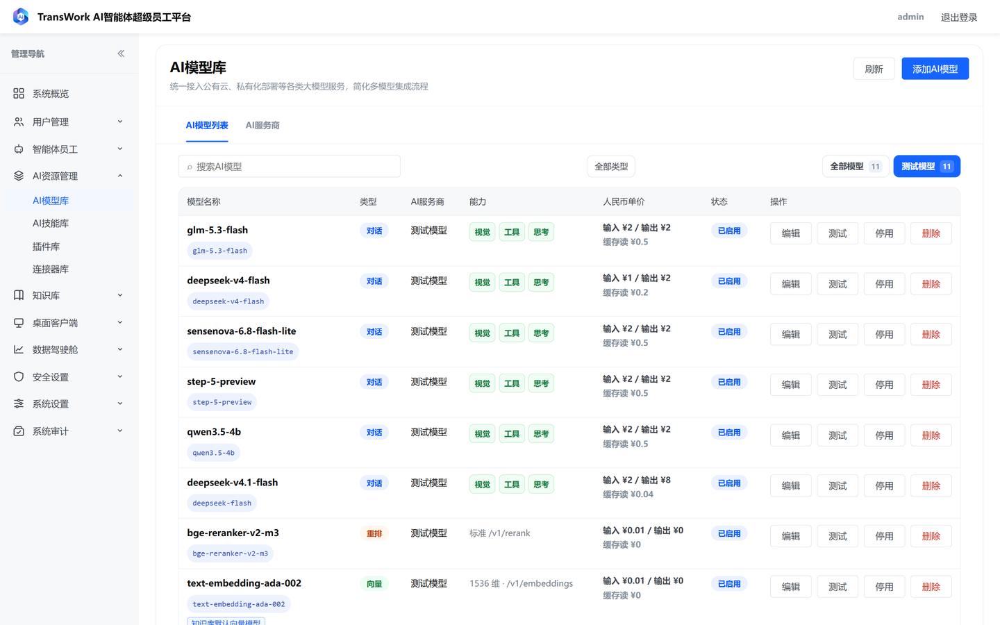 | 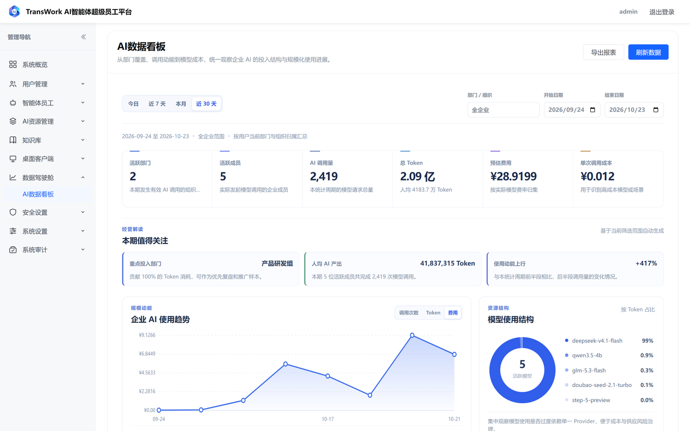 |
| **客户端管理** | **通用安全** |
| 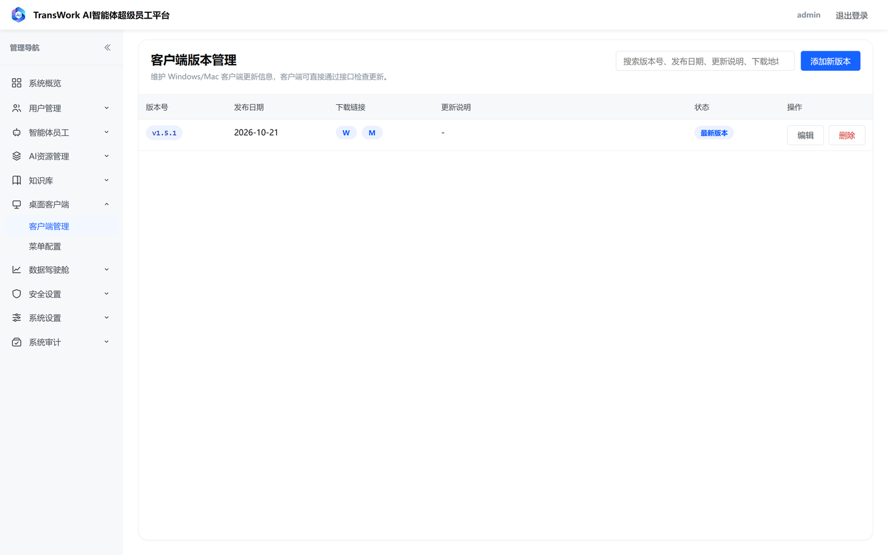 | 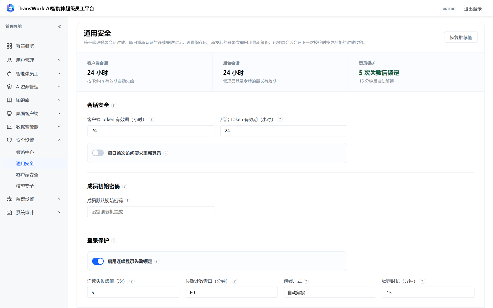 |

## 核心特性

| 能力 | 说明 |
| --- | --- |
| 技能市场（Skill Hub） | 技能包上传、分类管理、版本化分发，客户端一键获取 |
| 数字员工（Agent Hub） | 数字员工配置分发，按角色授予团队可用范围 |
| 桌面客户端 | Electron 工作台：任务/项目、技能、连接器、知识与交付物预览 |
| 浏览器版（WebAgent） | 后台起的独立 Web 服务，浏览器直接用同一套员工与技能，适合免安装试用与轻办公 |
| 命令执行沙箱 | WebAgent 可选开启容器化 Bash，支持生成 Word/Excel 等文档类交付物 |
| 知识库 | 文档解析 + pgvector 向量检索，支持后台解析任务与恶意文件扫描开关 |
| 模型网关 | 统一接入各家模型，主密钥 AES-GCM 加密存储，用量按用户/模型预聚合 |
| 单点登录 | 钉钉、企业微信、飞书、通用 OIDC、LDAP/AD、CAS，密钥仅存服务端 |
| 组织与权限 | 用户、角色、资源授权（按角色并集下发 Skill 与数字员工） |
| 安全策略 | 会话有效期、每日重新认证、登录失败锁定，服务端强制执行并记审计 |
| 品牌白标 | 自定义产品名称与 Logo，打造你自己的企业 AI 门户 |

## 免费授权说明

- 部署即自带**内置免费授权：5 个席位，无到期时间**，无需注册或导入授权码。
- 席位在用户首次登录时分配，同一用户重复登录不重复占用；5 席用满后新用户登录会被拒绝。
- 团队扩大后购买 License 并在「管理后台 → 组织配置 → 授权配置」导入授权码即可扩容；升级到不少于 5 席位的 License 时，现有席位自动迁移，已登录用户无需重新登录。
- 商业授权与更大规模私有化部署请通过 [官网](https://transwork.tree456.com/) 或 [GitHub Issues](https://github.com/shuyu-labs/transwork/issues) 联系我们。

## 在线体验（无需部署）

不想本地部署？直接使用我们的在线站点：

- **站点地址**：https://transwork.tree456.com/
- **管理后台**：https://transwork.tree456.com/admin
- **演示管理员账号**：`admin` / `TransWork_Admin_2026`

体验步骤：

1. 使用演示管理员账号登录管理后台，在「用户管理」中创建用户账号；
2. 下载并安装桌面客户端（见下文「桌面客户端」）；
3. 在客户端登录页点右下角「服务器设置」，将系统服务器地址配置为 `https://transwork.tree456.com/`；
4. 用创建的账号登录客户端，即可使用技能市场、数字员工与知识库。

> 演示站点为公开环境，请勿存放敏感信息；演示管理员账号仅用于功能预览，请勿修改站点配置或他人数据。

## 快速开始

> 推荐 Linux x86_64 服务器（Windows / macOS 可使用 WSL2 或任意云主机体验）。
> 以下命令在仓库根目录执行。

```bash
git clone git@github.com:shuyu-labs/transwork.git
cd transwork
docker compose up -d
```

首次启动会自动拉取四个镜像（Web、WebAgent、文档解析、PostgreSQL），完成 pgvector 扩展初始化、数据库建表与演示数据导入，等待约 1 分钟后访问：

| 入口 | 地址 | 默认账号 |
| --- | --- | --- |
| 产品官网 | http://localhost:3000/ | - |
| 管理后台 | http://localhost:3000/admin | `admin` / `TransWork_Admin_2026` |
| 技能市场 | http://localhost:3000/skill-hub | - |
| 数字员工 | http://localhost:3000/agent-hub | - |
| 浏览器版 WebAgent | http://localhost:4100/ | 后台创建的普通用户账号 |
| 文档解析服务 | http://localhost:5002 | - |

登录后台后，在「模型与系统」中配置你的模型接入，即可开始使用。

部署完成后建议跑一次自检，它会逐项检查四个容器、健康接口与命令执行配置：

```bash
sh verify.sh
```

部署细节（WebAgent 后台连接、HTTPS 反向代理、数据迁移与备份）见 [后台网站 Docker 部署操作手册](docs/后台网站Docker部署操作手册.md)。

## 架构


- 业务数据保存在命名卷 `transwork-postgres-data`，网站文件资产（Skill 包、Logo、机器码等）保存在命名卷 `transwork-data`。
- WebAgent 是独立容器（默认暴露 `4100`），会话、工作区与登录密钥保存在命名卷 `transwork-webagent-data`；它通过 Compose 内网地址 `http://transwork-web:3000` 调用后台 API 与模型网关。
- 容器会挂载宿主机 `/etc/machine-id` 与 `/sys/class/dmi/id/product_uuid` 生成稳定的系统识别码，授权码绑定该识别码。
- 所有镜像托管在阿里云容器镜像服务（ACR），国内服务器拉取速度快。

## 配置项

仓库自带的 `.env` 即为演示配置，开箱即用；公网部署请至少修改下表中标星项。

| 变量 | 说明 | 默认值 |
| --- | --- | --- |
| `PATH2AI_HTTP_PORT` ★ | 对外 HTTP 端口 | `3000` |
| `PATH2AI_PUBLIC_BASE_URL` ★ | 对外访问的根地址，SSO 回调基于它 | `http://localhost:3000` |
| `PATH2AI_ADMIN_USERNAME` | 管理后台账号 | `admin` |
| `PATH2AI_ADMIN_PASSWORD` ★ | 管理后台密码，请改为至少 16 位强密码 | `TransWork_Admin_2026` |
| `POSTGRES_*` ★ | 数据库库名/账号/密码，改密码后需同步修改两个连接串 | 见 `.env` |
| `PATH2AI_POSTGRES_CONNECTION_STRING` ★ | 业务连接串，密码含 `@`、`:`、`/` 时需 URL 编码 | 见 `.env` |
| `PATH2AI_MODEL_GATEWAY_MASTER_KEY` ★ | 模型网关主密钥，至少 32 位随机字符串，同时用于 SSO 密钥加密 | 见 `.env` |
| `WEBAGENT_HTTP_PORT` | 浏览器版 WebAgent 对外端口 | `4100` |
| `PATH2AI_WEB_BASE_URL` | WebAgent 服务端访问后台的地址，填 Compose 服务名而非 `localhost` | `http://transwork-web:3000` |
| `WEBAGENT_NODE_ENV` | HTTP 演示必须为 `development`（否则登录 Cookie 带 `Secure` 无法保持登录）；配了 HTTPS 后改 `production` | `development` |
| `WEBAGENT_SANDBOX` | 命令执行：`off` 只问答；`docker` 可生成 Word/Excel（需叠加沙箱文件） | `off` |
| `WEBAGENT_SANDBOX_IMAGE` | 沙箱镜像 | 见 `.env` |
| `WEBAGENT_SANDBOX_HOST_DATA_DIR` | `transwork-webagent-data` 卷在宿主机上的真实路径，`docker` 模式必填 | 空 |
| `DOCKER_CLI_PATH` / `DOCKER_GID` | 宿主机 docker CLI 路径与 docker 组 gid，叠加沙箱文件时使用 | `/usr/bin/docker` / `988` |
| `FILEEXT_HTTP_PORT` | 文档解析服务对外端口 | `5002` |
| `FILE_EXTRACTION_BASE_URL` | Web 容器访问解析服务的内网地址，保持 `http://fileext:5000` | `http://fileext:5000` |
| `FILE_EXTRACTION_SERVICE_TOKEN` | 解析服务 Bearer Token（未启用则留空） | 空 |
| `FILE_EXTRACTION_TIMEOUT_MS` | 解析超时时间 | `120000` |

> `.sh` / `.yaml` / `.env` 必须是 **LF** 换行。在 Windows 上被编辑器改成 CRLF 后，Linux 执行会报 `set: Illegal option -`。

## 桌面客户端

**网盘下载（夸克）**：https://pan.quark.cn/s/4b30591299e1 ，提取码：`8kb8`

也可在官网获取：https://transwork.tree456.com/

首次使用：在客户端登录页点右下角「服务器设置」，将系统服务器地址填为你的服务端地址（自建部署填自己的域名，在线体验填 `https://transwork.tree456.com/`），显示「服务器验证通过」后，用管理员在后台「用户管理」中分配的账号登录。SSO 登录方式会在客户端登录页自动发现，无需把平台密钥写入客户端。

不想安装客户端时，直接用浏览器访问 `http://<服务器IP>:4100/` 使用 WebAgent。它用后台已激活并分配角色的普通用户账号登录（不是管理员账号），会话与工作区独立保存在 `transwork-webagent-data` 卷中；后台需先完成授权、用户、角色与模型配置。

## 命令执行与文档生成（可选）

WebAgent 默认 `WEBAGENT_SANDBOX=off`，只能问答；要让数字员工生成 Word / Excel / PPT，需要三件事同时满足：

1. 宿主机拉取沙箱镜像：`docker pull registry.cn-hangzhou.aliyuncs.com/tree456/transwork-webagent-sandbox:1.0.0`
2. `.env` 改为 `WEBAGENT_SANDBOX=docker`，并把 `WEBAGENT_SANDBOX_HOST_DATA_DIR` 指向 `transwork-webagent-data` 卷的宿主机路径
3. 叠加沙箱配置启动：`docker compose -f docker-compose.yaml -f docker-compose.sandbox.yaml up -d transwork-webagent`

> 叠加文件会把宿主机 `/var/run/docker.sock` 交给 WebAgent，权限等同于 root，**仅限单机演示**。对外提供服务时请关闭命令执行或改用独立沙箱节点。

完整步骤、验收方法与常见问题见 [部署手册第 7 节](docs/后台网站Docker部署操作手册.md)。

## 生产部署安全清单

演示配置中的默认密码已随仓库公开，**公网部署前必须逐项确认**：

1. 修改 `PATH2AI_ADMIN_PASSWORD`（至少 16 位强密码）。
2. 修改数据库密码，并同步更新 `PATH2AI_POSTGRES_CONNECTION_STRING` 与 `PATH2AI_POSTGRES_ADMIN_CONNECTION_STRING`。
3. 重新生成 `PATH2AI_MODEL_GATEWAY_MASTER_KEY`（至少 32 位随机字符串）。
4. 配置 HTTPS 域名并设置 `PATH2AI_PUBLIC_BASE_URL`（根地址，不带路径），使用反向代理终止 TLS。
5. WebAgent 对外提供时，为它单独配一个 HTTPS 域名转发到 `4100`，并把 `WEBAGENT_NODE_ENV` 改为 `production`；代理需保留原始 `Host`、转发全部路径并关闭 SSE 缓冲。
6. 文档解析服务端口 `5002` 仅限内网访问，不要暴露到公网。
7. 保持 `WEBAGENT_SANDBOX=off` 或使用独立沙箱节点，不要把 `docker.sock` 挂给公网服务。
8. 不要执行 `docker compose down -v`，除非确认要删除全部业务数据。

## 常用命令

```bash
docker compose up -d          # 启动（四个容器）
docker compose ps             # 查看状态
docker compose logs -f transwork-web      # 网站日志
docker compose logs -f transwork-webagent # WebAgent 日志
docker compose logs pgvector-init         # 数据库初始化日志
sh verify.sh                  # 部署自检：容器、健康接口、命令执行配置
docker compose down           # 停止（保留数据）
docker compose pull && docker compose up -d   # 升级到最新镜像
```

数据备份：业务数据在卷 `transwork-postgres-data`，文件资产在卷 `transwork-data`，WebAgent 工作区在卷 `transwork-webagent-data`，升级前建议先备份。

## 文档与手册

| 文档 | 适合谁看 | 内容 |
| --- | --- | --- |
| [TransWork 平台操作手册（零基础版）](docs/TransWork%20平台操作手册（零基础版）.pdf) | 企业管理员与业务人员 | 102 页图文全流程：官网展示、后台登录、用户管理、智能体员工、AI 资源管理、知识库、数据驾驶舱、安全与系统设置 |
| [TransWork 客户端用户操作手册](docs/TransWork客户端用户操作手册.pdf) | 终端用户 | 73 页零基础图文：安装登录、对话使用、AI 员工、任务日历、技能中心、连接器、知识库与常见问题 |
| [后台网站 Docker 部署操作手册](docs/后台网站Docker部署操作手册.md) | 运维 / 部署人员 | 首次部署、WebAgent 与 HTTPS、命令执行沙箱、数据迁移、备份与恢复完整流程 |

## 交流与支持

欢迎扫码加入微信交流群，或添加作者微信反馈问题、交流使用心得：

| 交流群 | 作者微信 |
| --- | --- |
|  |  |

- 问题反馈与功能建议：[GitHub Issues](https://github.com/shuyu-labs/transwork/issues)
- 商业授权、私有化部署咨询：[官网](https://transwork.tree456.com/)
